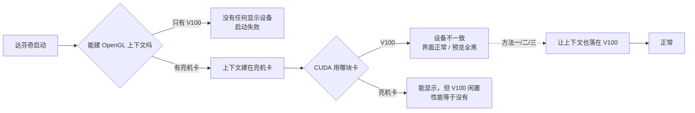
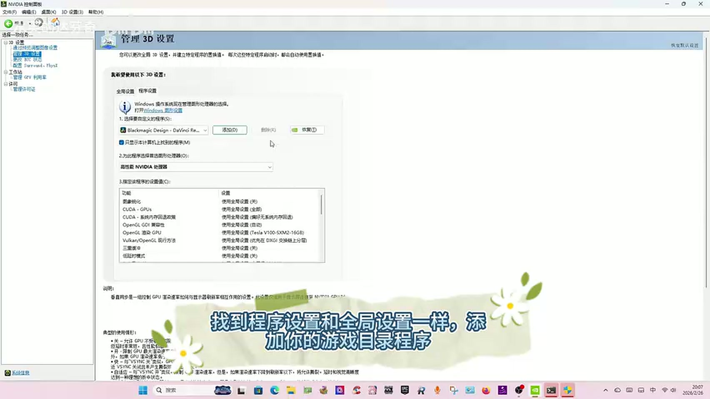
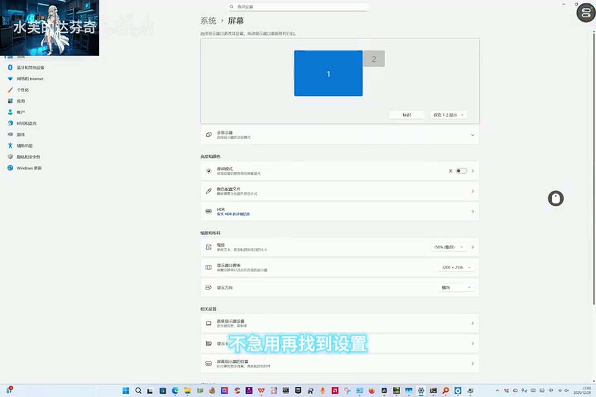
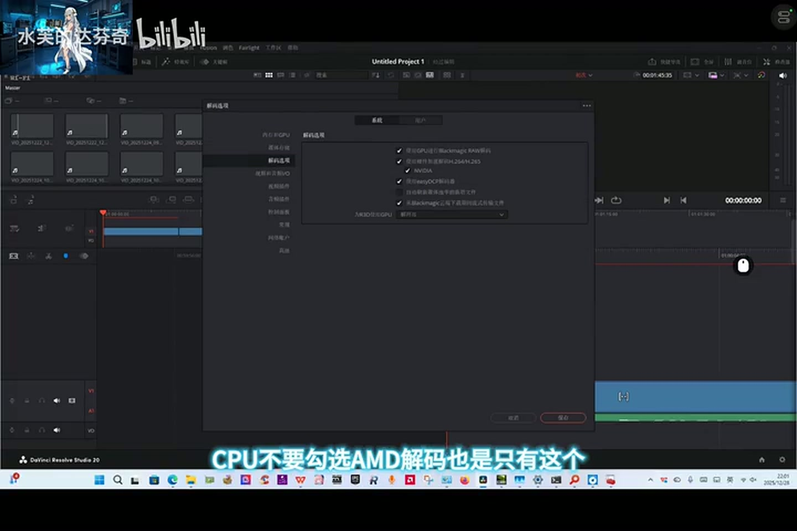

# Tesla V100 + DaVinci Resolve：黑屏的原因与三种解法

> **Why DaVinci Resolve goes black on a Tesla V100 (Windows), and three workarounds that fix it.**
>
> 一块无显示输出的数据中心计算卡，配一张亮机卡，让达芬奇正常启动、正常预览、不黑屏。
> 整理自 B 站 UP 主「水芙的达芬奇」的三条视频，逐帧核对画面与旁白后重新编排。

**本仓库不发明任何方法。** 方案、操作思路与实测数据归原作者（引用见文末）。这里只做三件事：解释黑屏的成因、把散在三条视频里的步骤结构化、把视频与简介/置顶评论不一致的地方标出来。

---

## 先看症状：你在哪一层黑

“黑屏”在达芬奇这套组合里有三种完全不同的表现，对应三个不同环节。先对上号，再选方案。

| 症状 | 发生在哪 | 直接原因 |
|---|---|---|
| **A. 双击图标没反应 / 启动即闪退** | 进程启动阶段 | 找不到任何能创建 OpenGL 上下文的设备 |
| **B. 界面能开，媒体池是黑的，一按播放就黑** | 预览/解码阶段 | 界面建在亮机卡，CUDA 解码被指到 V100，两块卡不是同一设备 |
| **C. 项目管理器正常，进项目后监视器全黑，时间线能拖动** | 项目加载阶段 | 同 B，但 OpenGL 上下文在切换项目时被重建到了错误设备 |

本仓库三条方案主要解决 **B 和 C**。如果你的症状是 A，说明系统里根本没有可用的显示输出设备，得先插一张亮机卡。

---

## 为什么黑屏

不是达芬奇坏了，也不是 V100 坏了。是三个各自合理的设定撞在一起。

### 第一层 · V100 在 Windows 上不是一块“显示卡”

V100 是数据中心计算卡，**卡上没有任何显示输出接口**（没有 HDMI / DP）。更关键的是驱动模式：Windows 下 Tesla 系列只跑 **TCC（Tesla Compute Cluster）**，不进 WDDM 图形栈——系统不把它列为显示适配器，也就无法在它上面创建桌面、DXGI 表面或 OpenGL 上下文。

**它只能算，不能画。** 这是产品定位，不是故障。

### 第二层 · 达芬奇的界面是 OpenGL 画的

Windows 版达芬奇启动时会做两件事，顺序固定：

1. 找一块**当前正在承担显示输出**的 GPU，建 OpenGL 上下文——整个 UI（项目管理器、时间线、监视器）都画在这个上下文里
2. 再按偏好设置，决定用哪块卡做 CUDA 解码、降噪、OFX

于是两种配置都走不通：

| 配置 | 结果 |
|---|---|
| 只有 V100 | 第 1 步就失败，**根本起不来** |
| V100 + 亮机卡 | 第 1 步建在亮机卡上，第 2 步指向 V100 → 两者不是同一设备，**界面能出、画面全黑** |

关键点在于：**界面 GPU ≠ 计算 GPU 时，达芬奇不做降级**。它不会退回软件 OpenGL，也不会自动把解码切回亮机卡，而是直接给你一块黑监视器。Premiere 这类会降级，达芬奇不会。

### 第三层 · Windows 只允许一块卡当“主显示”

双卡且其中一块无输出时，桌面合成被固定给那块有输出的卡。应用能选“用哪块卡做 3D 计算”，但**不能选“用哪块卡画界面”**——这个由系统的主显示设备决定，应用层没有开关。

达芬奇也没有提供独立的「界面渲染 GPU」选项，它的偏好设置里只有「用于 3D 处理的 GPU」。

### 一句话总结

> **黑屏 = OpenGL 上下文建在 A 卡上，CUDA 处理落在 B 卡上，而达芬奇要求两者必须是同一块卡。**

所以三条方案的本质是同一件事：

> **让 OpenGL 上下文和 CUDA 处理落在同一块卡上，且这块卡是 V100。**

区别只在“怎么骗”：

- **方法一**改系统 → 强制 OpenGL 加载 NVIDIA 的 ICD
- **方法二**改应用层 → 让达芬奇不再觉得两块卡“不是一家人”（同厂商 ICD 可复用）
- **方法三**改显示环境 → 物理上把另一块卡藏起来，系统没有第二选择



---

## 我们怎么做

先按亮机卡的类型分流，这是唯一的分叉点。

| 你的情况 | 走哪条 | 步骤数 | 成本 |
|---|---|---|---|
| 亮机卡是 **NVIDIA**（P620 / GT 1030 / 核显除外） | [方法二](docs/02-nvidia.md) | 3 步 | 最低，首选 |
| 亮机卡是 **AMD**（RX 580 等） | [方法三](docs/03-amd.md) | 14 步 | 需要网易 UU 远程 |
| 没有亮机卡 / 想要持久生效 | [方法一](docs/01-registry.md) | 8 步 | 改注册表，风险最高 |

### 方法一 · 注册表批处理（改系统层）

用管理员权限跑 `select_GPU.bat`，批量改写 `UserGpuPreferences` 与 OpenGL ICD 注册表项，把 OpenGL 的加载路径强制指向 NVIDIA 驱动；配合 NVIDIA 控制面板把 OpenGL 渲染 GPU 与 PhysX 都设为 V100。

- ✅ 生效面最广，对所有程序一致
- ⚠️ **脚本源码作者没有公开**，视频只演示运行过程——这是三条方案里唯一无法完整复现的一环
- ⚠️ 会一次性覆盖本机**所有**程序的 GPU 首选

### 方法二 · NVIDIA 亮机卡（改应用层）

只改两处：Windows「显示卡」里把默认性能 GPU 设为 V100；达芬奇「偏好设置 → 内存和 GPU」里**取消「自动」、只勾 V100**。

- ✅ 三分钟搞定，完全可逆，不碰注册表
- ⚠️ 关键是**取消「自动」**。勾着它，负载会全压到亮机卡上，V100 的 3D 占用接近零
- ⚠️ 亮机卡显存建议 **≥ 3.5 GB**，低于此值快速预览会卡成 PPT，甚至掉驱动

### 方法三 · AMD 亮机卡 + 网易 UU 虚拟屏（改显示环境）

AMD 与 NVIDIA 的 OpenGL ICD 是两套实现，无法共存，所以不能像方法二那样“复用同一家的驱动”。只能让 V100 成为**唯一可见的显示设备**：

1. 设备管理器禁用 AMD 亮机卡
2. 用网易 UU 远程的「被控端防窥模式 → 关闭显示屏」熄掉物理屏
3. 屏幕设置切到「仅在 1 上显示」，让达芬奇只能看到远程虚拟屏
4. 此时启动达芬奇，OpenGL 上下文和 CUDA 都落在 V100
5. 启用 AMD 卡、恢复防窥、屏幕切回「仅在 2 上显示」
6. 从主机上重开项目，关掉 UU 里那个旧窗口

- ✅ 唯一能在 A 卡亮机环境下走通的路
- ⚠️ **顺序不能乱**，第 3 步物理屏必须真的熄灭
- ⚠️ 作者另有一条**置顶评论版**，用「断开重连」代替「关屏 + 切显示」，两者不一致，文档里做了逐条对照

---

## 三个方案对比

| | 方法一 | 方法二 | 方法三 |
|---|---|---|---|
| **亮机卡** | 任意（甚至没有） | NVIDIA（如 P620） | AMD（如 RX 580） |
| **改动层级** | 系统 / 注册表 | 应用层 | 显示环境 |
| **需要什么** | 管理员权限 + 批处理脚本 | 无 | 网易 UU 远程 |
| **可逆性** | 差 | 好 | 好 |
| **持久性** | 强，但系统更新会重置 | 中 | 弱，靠一次会话状态 |
| **步骤数** | 8 | 3 | 14 |
| **原视频** | [BV1HxAkzjEm6](https://www.bilibili.com/video/BV1HxAkzjEm6) | [BV1LRr5BTEHM](https://www.bilibili.com/video/BV1LRr5BTEHM) | [BV1CT62BvEt6](https://www.bilibili.com/video/BV1CT62BvEt6) |

**为什么 Windows 一更新就全废**
方法一、二依赖系统图形栈的具体行为：谁被判定为主显示设备、`UserGpuPreferences` 的优先级、双卡合成走哪块。Windows 一改图形栈，这些前提就复位了。方法三之所以更耐用，是因为它不指望系统判断，而是**物理上让另一块卡消失**。

---

## 关键设置对照

**① NVIDIA 控制面板 → 管理 3D 设置 → 程序设置**（方法一，0:25）

添加的是 `Blackmagic Design - DaVinci Resolve`——注意视频旁白在这里说的是“添加你的游戏目录程序”，**以画面为准**。



**② Windows 设置 → 系统 → 屏幕 → 显示卡**（方法三，01:01）

选「仅在 1 上显示」，让物理屏熄灭——这一步是方法三的成败关键。



**③ 达芬奇 → 偏好设置 → 解码选项**（方法三，04:04）

只勾 NVIDIA，不勾 AMD。少这一步，前 12 步做完进项目照样黑。



---

## 已知的坑

1. **`select_GPU.bat` 没有源码**。方法一的核心脚本，视频只演示运行，没有下载地址。
2. **方法三的简介与视频不一致**。简介（也是 UP 主置顶评论）写的是「断开远程 → 快速重连 → 点小房子重开项目管理」，视频演示的是「防窥关屏 → 屏幕切仅 1 → 再切回仅 2」。
3. **`-GraphicsAdapter` 只对游戏有效**。那是 DXGI 参数，达芬奇走 OpenGL/CUDA，不依赖它。第一条视频后半段讲的是游戏，容易被误读。
4. **第一条视频只验证到「界面能显示」**，没验证解码播放。界面正常不代表能播。
5. **都依赖系统版本**。作者明说方法三是「Windows 更新后的改法」，系统再更新可能再次失效。

---

## 引用

本仓库内容整理自以下三条视频。**技术方案、操作思路与实测数据均归原作者。**

**作者**：水芙的达芬奇（Bilibili，UID `629073869`）

1. 《解决无头计算卡 V100 因为 WINDOWS 系统 BUG 调用不了 UNITY 游戏的情况》
   https://www.bilibili.com/video/BV1HxAkzjEm6
2. 《邪修宝典：V100 和英伟达显卡正常使用达芬奇，双显卡预览不黑屏》
   https://www.bilibili.com/video/BV1LRr5BTEHM
3. 《邪修宝典：V100+AMD 亮机卡用达芬奇播放不黑屏教程 2》（P1 + P2）
   https://www.bilibili.com/video/BV1CT62BvEt6

```bibtex
@misc{shuifu2026v100unity,
  author = {水芙的达芬奇},
  title  = {解决无头计算卡V100因为WINDOWS系统BUG调用不了UNITY游戏的情况},
  year   = {2026},
  url    = {https://www.bilibili.com/video/BV1HxAkzjEm6},
  note   = {Bilibili}
}

@misc{shuifu2026nvidia,
  author = {水芙的达芬奇},
  title  = {邪修宝典：V100和英伟达显卡正常使用达芬奇，双显卡预览不黑屏},
  year   = {2026},
  url    = {https://www.bilibili.com/video/BV1LRr5BTEHM},
  note   = {Bilibili}
}

@misc{shuifu2026amd,
  author = {水芙的达芬奇},
  title  = {邪修宝典：V100+AMD亮机卡用达芬奇播放不黑屏教程2},
  year   = {2026},
  url    = {https://www.bilibili.com/video/BV1CT62BvEt6},
  note   = {Bilibili}
}
```

核对方法（时间戳、逐帧截图、5 处视频与文案不一致）见 [REFERENCE.md](REFERENCE.md)。

---

## 免责声明

- 方法一涉及**注册表修改**，方法三涉及**显示驱动与远程工具**。操作前请创建系统还原点，重要工程先备份。
- 这些方法都**不属于 Blackmagic Design 或 NVIDIA 的官方支持范围**。
- 文档中的时间戳、旁白与画面均来自原视频，**实际效果以你的机器为准**。
- 若用于生产环境，建议改用官方支持的配置：加一张 ≥ 4 GB 的 NVIDIA 亮机卡走方法二，或直接用消费级 / Quadro 显卡。

---

## License

文档内容采用 [CC BY-SA 4.0](https://creativecommons.org/licenses/by-sa/4.0/) 许可。转载、修改、再分发均可，**必须保留原作者署名与本仓库链接**，衍生作品需使用相同许可。

视频截图版权归原作者所有，此处仅作技术说明之用。
