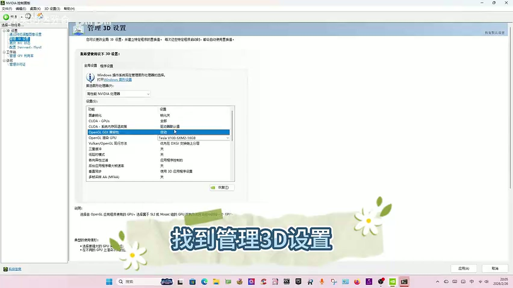
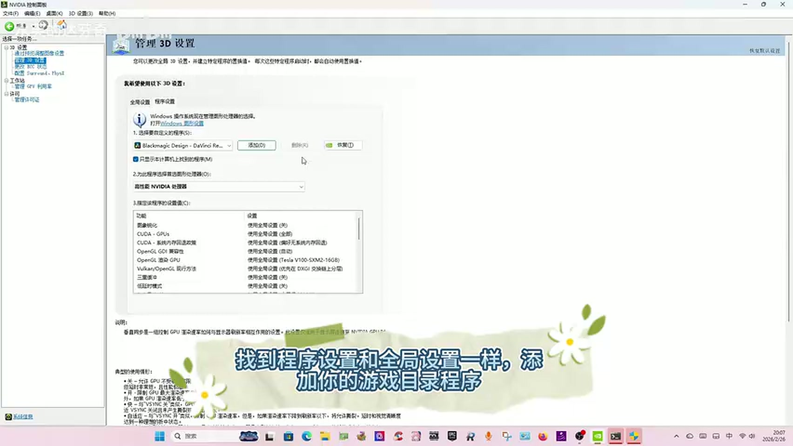
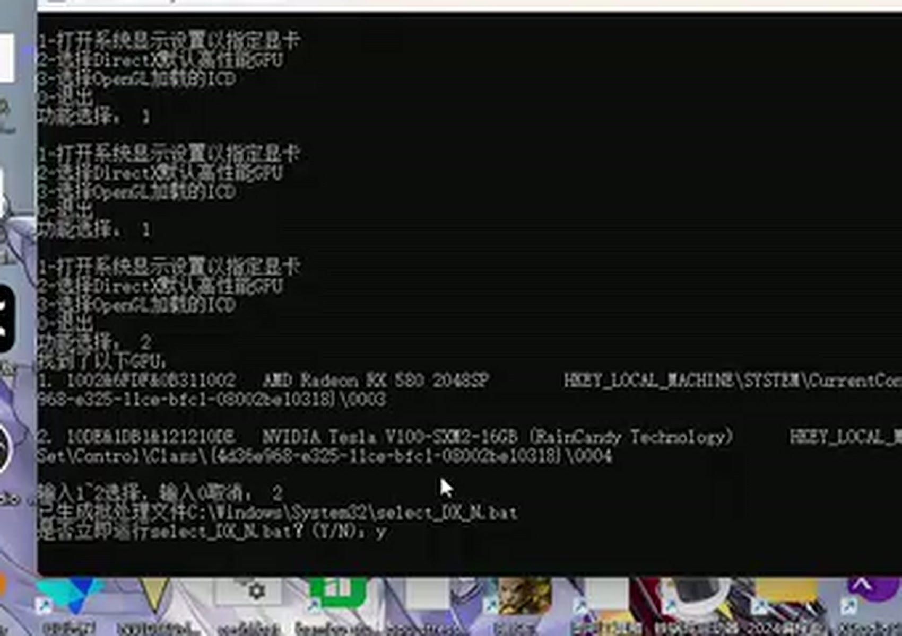
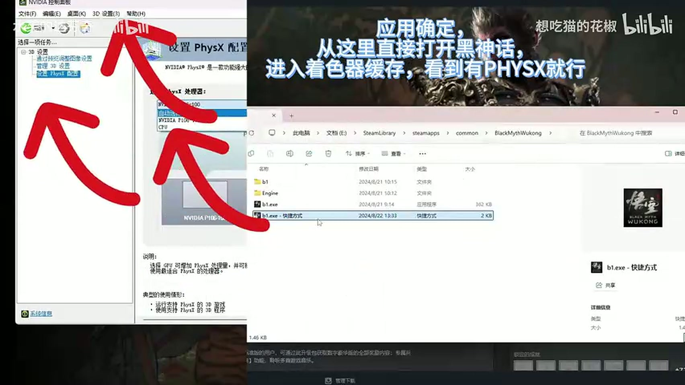

# 方法一 · 注册表批处理（OpenGL ICD 重定向）

> 原视频：[BV1HxAkzjEm6](https://www.bilibili.com/video/BV1HxAkzjEm6)　作者：水芙的达芬奇
> 适用：任意亮机卡，或**完全没上亮机卡**的无头 V100 机器
> 代价：改注册表，全局生效，不可轻易回滚

---

## 这条方案在做什么

Windows 上 OpenGL 只加载**一个**实现（ICD），由主显示设备决定。V100 是 TCC 模式，拿不到这个位置，所以达芬奇建不出 OpenGL 上下文。

这条方案不走「换显示设备」，而是**直接在系统层把 OpenGL 的加载目标改成 NVIDIA 的 ICD**，顺带把 DX 的默认高性能 GPU 也钉到 V100 上。改完之后，应用层看到的就是「默认 GPU 一直是 V100」。

---

## 步骤

### ① `0:08 – 0:15`｜NVIDIA 控制面板 → 全局设置

打开 **NVIDIA 控制面板 → 管理 3D 设置 → 全局设置**：

| 选项 | 设为 |
|---|---|
| **OpenGL 渲染 GPU** | `Tesla V100-SXM2-16GB` |
| **CUDA - 系统内存回退政策** | **优先无系统内存回退** |

> 原话：「OpenGL 渲染 GPU 选 V100，CUDA 系统内存回退政策选优先无系统内存回退。」



**为什么第二项也要改**：V100 没有显示输出，一旦显存不够触发「回退到系统内存」，画面会经由主机内存绕一圈，在达芬奇这种实时预览场景里就是卡死。关掉回退，宁可报错也不要静默降级。

### ② `0:19 – 0:28`｜程序设置里添加达芬奇

同一面板 → **程序设置** → 「添加」→ 选 **`Blackmagic Design - DaVinci Resolve`**。

添加后，下方「OpenGL 渲染 GPU」保持「**使用全局设置**」，直接应用。



> ⚠️ **这里旁白和画面是矛盾的。** 旁白说的是「添加你的游戏目录程序」，但画面里添加的明确是 `Blackmagic Design - DaVinci Resolve`，下方一栏写着「使用全局设置 (Tesla V100-SXM2-16GB)」。
>
> 以画面为准。这条视频的标题讲的是 Unity 游戏，但这一段实际在配达芬奇，后面 1:40 之后才切到游戏（`b1.exe`）。

### ③ `0:32 – 0:45`｜Windows 显示卡设置

**设置 → 系统 → 屏幕 → 显示卡 → 高级图形设置**：

- **默认性能 GPU** → `NVIDIA Tesla V100-SXM2-16GB`
- **硬件加速 GPU 计划** → 保持**关闭**

`硬件加速 GPU 计划`开着会引入另一套显存管理路径，在 TCC 卡上表现不稳定，作者让保持关闭。

### ④ `0:50 – 1:00`｜把 Resolve.exe 加进应用列表

同一页面下方「**应用的自定义设置**」→ **添加应用** → 浏览到：

```
C:\Program Files\Blackmagic Design\DaVinci Resolve\Resolve.exe
```

添加后点「选项」→ **GPU 首选项** → **高性能**。

### ⑤ `1:00 – 1:40`｜管理员运行 `select_GPU.bat`

以**管理员身份**运行 `C:\Windows\System32\select_GPU.bat`，菜单四项：

```
1  打开系统显示设置以指定显卡
2  选择 DirectX 默认高性能 GPU
3  选择 OpenGL 加载的 ICD
0  退出
```

操作顺序：

1. 选 **`1`**（打开系统显示设置，即上一步的页面）
2. 回到脚本，选 **`2`**
3. 脚本列出两块卡：`1. AMD RX 580 2048SP` / `2. NVIDIA Tesla V100-SXM2-16GB`
4. 输入 **`2`** → 生成 `select_DX_N.bat` → 提示「是否立即运行? (Y/N)」→ 输入 **`Y`**
5. 回菜单选 **`3`** → 同样选 **`2`** → 生成并运行 `select_GL_N.bat`

跑完屏幕会滚过一屏「修改成功。」



> ⚠️ **这个脚本没有公开源码，也没有下载地址**，视频只演示了运行。它批量改写的是 `UserGpuPreferences` 与 OpenGL ICD 相关的注册表项，**会覆盖本机所有程序**的 GPU 首选。这是三条方案里唯一无法从视频完整复现的一环，需要向作者索取或自行实现。

### ⑥ `1:40 – 3:50`｜重启

脚本首次运行会提示「需在重启后生效」。重启。

### ⑦ `3:50 – 5:00`｜设备管理器验证

**设备管理器 → 显示适配器**：

1. 右键 **AMD Radeon RX 580 2048SP** → **禁用设备**
2. 启动达芬奇，确认能起、界面正常
3. 退出达芬奇
4. **重新启用**亮机卡
5. 再启动达芬奇，确认仍然走 V100

这一步是验证「IDC 已经被钉死」，而不是靠「亮机卡不可用」侥幸绕过。

### ⑧ `5:30`｜PhysX 配置

**NVIDIA 控制面板 → 设置 PhysX 配置 → 处理器** → 选 `NVIDIA Tesla V100-SXM2-16GB`。

**不要选「自动选择」**，否则物理计算可能落到亮机卡上。



---

## 只有游戏需要的一步

如果目标是 Unity / DirectX 游戏（不是达芬奇），还需要给可执行文件加强制参数：

1. 给 `b1.exe` 建快捷方式
2. 属性 → 目标末尾加一个空格，追加：

```
-dx12 -GraphicsAdapter=0000
```

`0000` 是 DXGI 适配器序号，表示「第一块 DX 适配器」，在只有 V100 可用时即指向 V100。

> **达芬奇不需要这一步。** `-GraphicsAdapter` 是 DXGI 参数，达芬奇走 OpenGL/CUDA，靠 ①②⑤ 生效。

---

## 风险与回滚

| 风险 | 说明 |
|---|---|
| 全局生效 | 脚本改的是机器级 GPU 首选，影响**所有**程序，不只是达芬奇 |
| 回滚困难 | 没有备份脚本，也没有「还原」菜单；需要手动清理 `UserGpuPreferences` 或系统还原点 |
| 系统更新重置 | 大版本更新可能覆盖这些注册表项，需要重跑 |
| 源码不可得 | 无法审计脚本具体改了哪些键 |

**动手前先创建系统还原点。** 这是三条方案里唯一不建议在生产机上直接试的一条。
