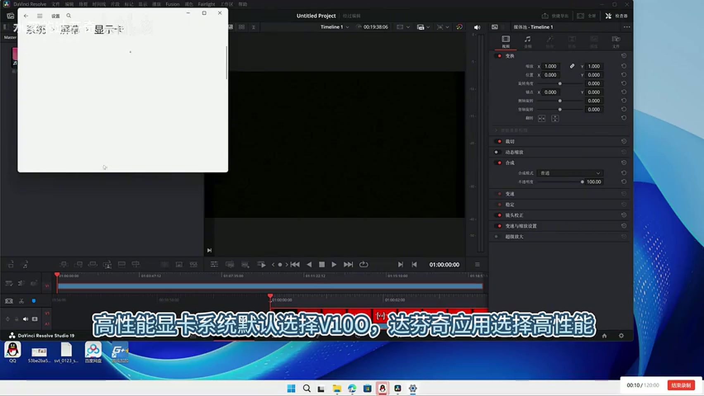
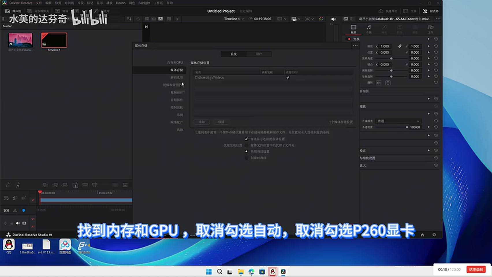

# 方法二 · NVIDIA 亮机卡

> 原视频：[BV1LRr5BTEHM](https://www.bilibili.com/video/BV1LRr5BTEHM)　作者：水芙的达芬奇
> 适用：亮机卡是 **NVIDIA**（P620、GT 1030、T400 等）
> 代价：改两处设置，可随时改回，不碰注册表

---

## 为什么 NVIDIA 亮机卡这么简单

AMD 和 NVIDIA 的 OpenGL 实现是两套独立 ICD，Windows 只能加载其中一个，所以 A 卡组合必须靠「藏起物理屏」硬来（见[方法三](03-amd.md)）。

而同为 NVIDIA 时，两块卡共用一个 ICD 家族，驱动内部就能把「显示」和「计算」分开处理。达芬奇不再觉得两块卡「不是一家人」，只要在偏好设置里明确指定计算卡即可。

---

## 步骤

### ① `0:20 – 0:35`｜Windows 显示卡设置

**设置 → 系统 → 屏幕 → 显示卡**（图形设置）：

1. **默认性能 GPU**（系统默认）→ 选 **V100**
2. 下方应用列表找到 **达芬奇** → 选项 → **高性能**

> 原话：「高性能显卡系统默认选择 V100，达芬奇应用选择高性能。总之，选择 V100 就对了，不管是特定还是高性能。」

### ② `0:36 – 0:48`｜达芬奇偏好设置里只留 V100

打开达芬奇 → **偏好设置**（Preferences）→ 左侧 **内存和 GPU**（Memory and GPU）：

1. **取消勾选「自动」**
2. **取消勾选亮机卡**（视频里是 P620）
3. **只勾选 V100**
4. 保存，重启达芬奇

> 原话：「打开达芬奇，找到偏好设置，找到内存和 GPU，取消勾选自动，取消勾选 P620 显卡，仅仅勾选 V100。教程完了，正常预览不黑屏。」

### ③ 完成

没有第三步。视频剩下的三分钟都在讲原理和实测数据。

---

## 为什么必须关掉「自动」

这是整条方案唯一容易漏的一步。

勾着「自动」时，达芬奇会把负载**优先分配给承担显示输出的那块卡**——也就是亮机卡。结果是：

- 亮机卡显存被吃满，V100 的 3D 占用和解码器几乎为零
- 导出时大量占用亮机卡显存，速度反而慢
- 显存不够时掉驱动、卡死、黑屏

手动只勾 V100，渲染才真正落到 V100 上。

---

## 实测数据（作者提供）

| 项目 | 数值 |
|---|---|
| 亮机卡显存**下限** | **≥ 3.5 GB**（低于此值快速预览会卡成 PPT，甚至掉驱动黑屏） |
| 无负载占用 | 约 1 GB |
| 有负载 | 约 1.5 GB |
| 导出满载 | 约 1.8 GB |
| 走 UU 串流方式 | 仅 **0.4 GB**，负载转移到 V100 和 CPU |

4K 两分钟素材导出耗时对比：

| 配置 | 耗时 |
|---|---|
| P620 单卡 | 52 秒 |
| RX 580 单卡 | 37 秒 |
| AMD 亮机卡 + V100（方法三） | 38 秒 |

> 可以看出：这套方案的价值不在「比单卡更快」，而在**本来跑不起来**。38 秒对 37 秒的差距，换来的是 V100 的 CUDA 和大显存可用。

---

## 一个反直觉的现象

作者在答疑里提到：如果亮机卡是**驱动支持的非原生 DX12** 型号，在达芬奇的双卡 bug 下仍然会出问题；而用 **Quadro** 这类专业卡，反而因为驱动自带特性识别而正常。

所以「NVIDIA 亮机卡」不是一个充分条件，具体型号仍有差异。P620 是作者验证过的，其他型号建议先用方法二试，不行再退到方法三。

---

## 优缺点

| | |
|---|---|
| ✅ 简单 | 两处设置，五分钟 |
| ✅ 可逆 | 随时改回，不碰注册表 |
| ✅ 稳定 | 不依赖远程工具或显示会话状态 |
| ⚠️ 需要亮机卡 | 且建议 ≥ 3.5 GB 显存 |
| ⚠️ 型号敏感 | 非原生 DX12 的卡可能仍然黑屏 |
| ⚠️ 系统更新 | 大版本更新后可能需要重设 |
