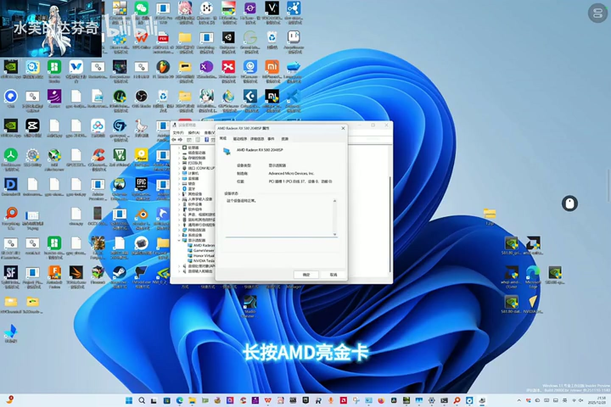
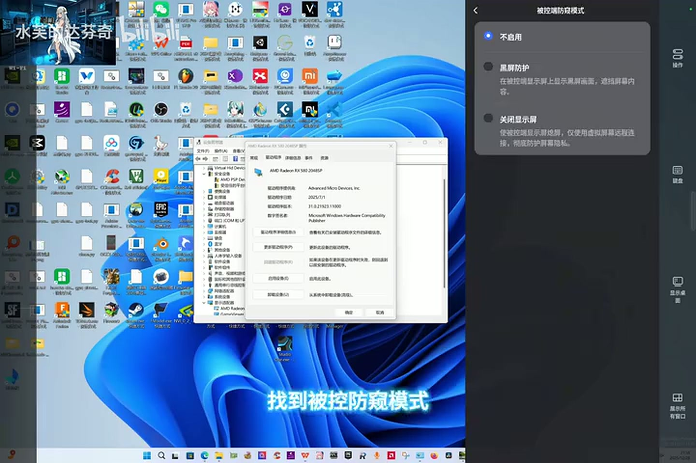
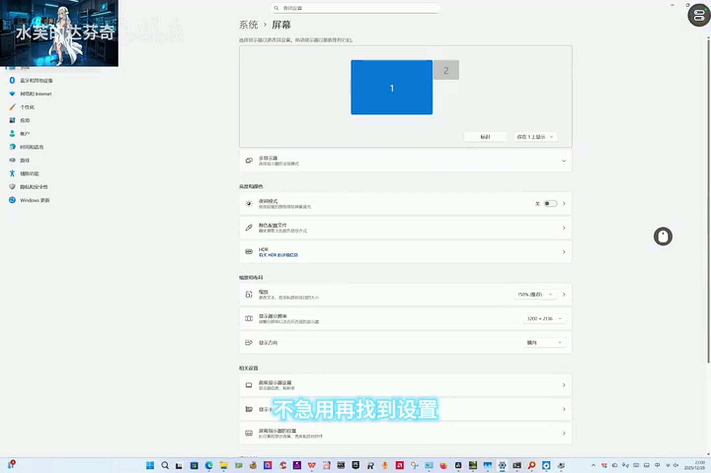
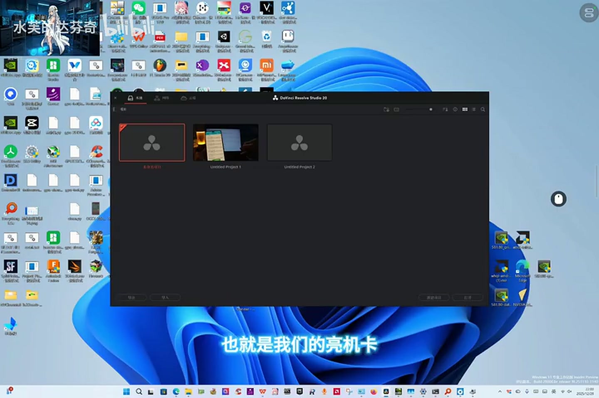
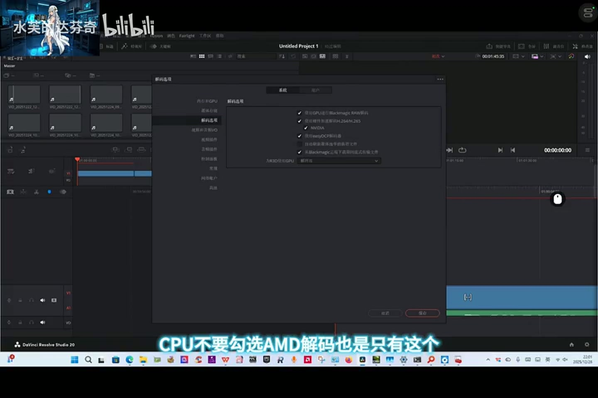

# 方法三 · AMD 亮机卡 + UU 虚拟屏

> 原视频：[BV1CT62BvEt6](https://www.bilibili.com/video/BV1CT62BvEt6)（P1 4:27 + P2 2:05）　作者：水芙的达芬奇
> 适用：亮机卡是 **AMD**（RX 580 等）
> 代价：13 步，顺序不能乱，全程在远程窗口里操作

---

## 为什么 A 卡必须「邪修」

AMD 和 NVIDIA 各有自己的 OpenGL ICD，Windows 在同一时刻只加载一个，由主显示设备决定。只要物理显示器还挂在 RX 580 上，OpenGL 就归 AMD，V100 永远拿不到上下文。

方法一能改注册表强夺，方法二能靠同厂商 ICD 复用，A 卡两者都不成立。所以只剩一条路：

> **让物理屏消失。** 物理屏一灭，达芬奇只能看到远程串流出来的虚拟屏，于是把渲染交给 V100；等它完成初始化，再把物理屏换回来，它已经不会再黑。

这不是修好达芬奇，是**骗过它一次初始化**。

---

## 准备工作

| 需要 | 说明 |
|---|---|
| 网易 UU 远程 | 被控机和操作端都装，登录同一账号 |
| 一块 AMD 亮机卡 | 视频里是 RX 580 2048SP |
| 一块 V100 | 无显示输出，正常 |
| 一台操作设备 | 手机、平板、另一台电脑都行 |

全程在 **UU 远程窗口里**操作，不要在物理机前动键鼠。

---

## 视频里的实际步骤（12 步）

### `00:00` ① 建立远程

被控机装好 UU 远程，另一台设备连上，进入桌面。

> 原话：「首先我们准备好我们的网易 UU，准备好和它连接，之后我们进入桌面。」

### `00:13` ② 打开设备管理器

开始菜单右键 → **设备管理器** → 展开 **显示适配器**。

### `00:39` ③ 禁用 AMD 亮机卡

右键 **AMD Radeon RX 580 2048SP** → **禁用设备** → 确认。

> 原话：「长按 AMD 亮机卡，点击禁用设备。」

此时系统里只剩 V100 一块「显卡」，但它没有输出，画面还在靠远程的虚拟屏维持。

### `00:45` ④ UU 里关闭物理显示屏

UU 远程 → **设置 → 安全 → 被控端防窥模式** → 选 **关闭显示屏**。

三个选项是：**不启用** / **黑屏防护** / **关闭显示屏**。第三个的说明写着「使被控端屏幕熄屏，仅使用虚拟屏幕远程连接」。

### `01:01` ⑤ 屏幕设置切到虚拟屏

**设置 → 系统 → 屏幕** → 显示器下拉 → **仅在 1 上显示** → **保留更改**。

此时 1 号屏是蓝色的虚拟屏，2 号屏灰掉。

### `01:22` ⑥ 确认物理屏真的灭了

走到机器前看一眼。**如果物理屏还亮着，切回去重做**，多试几次直到它不亮。

> 原话：「可以看到我们的现实屏幕并没有亮起，可以多试几次，确保我们的现实屏幕并没有亮起。」

这一步是整套方案的成败点。物理屏没灭，达芬奇就还能看到 AMD，后面全白做。

### `01:37` ⑦ 确认默认 GPU

**设置 → 系统 → 屏幕 → 显示卡 → 高级图形设置** → **默认性能 GPU** → **让 Windows 决定**。

此时只剩 V100 一块可用卡，让系统自己挑即可。画面里显示「让 Windows 决定 (NVIDIA Tesla V100-SXM2-16GB)」。

> 注意：这里选的是「让 Windows 决定」，**不是**「高性能」，和方法二相反。

### `01:50` ⑧ 把达芬奇加进应用列表

同一页面 → **添加应用** → 选 `Resolve.exe` → **GPU 首选项** → **让 Windows 决定**。

路径一般为 `D:\Program Files\Blackmagic Design\DaVinci Resolve\Resolve.exe`。

### `02:12` ⑨ 打开达芬奇

回桌面打开达芬奇。项目管理器应当**正常显示、不黑屏**。

- 画面不理想时把**分辨率调高一点**，UU 会自动开启超级屏
- 打开**任务管理器 → 性能**，确认列表里**没有 RX580**

> 原话：「可以看到我们的显示是始终要开启超级屏的，分辨率可以调高一点，它就自动开启超级屏了。」

### `02:50` ⑩ 启用 AMD 亮机卡

设备管理器 → 显示适配器 → 右键 AMD → **启用设备**。

**达芬奇会瞬间黑屏——这是正常的**，下一步马上救回来。

### `03:13` ⑪ UU 关掉防窥模式

UU → **设置 → 安全 → 被控端防窥模式** → 改回 **不启用**。

### `03:25` ⑫ 画面切回物理屏

**设置 → 系统 → 屏幕** → 下拉 → **仅在 2 上显示** → 确认物理显示器亮起 → **保留更改**。

> 原话：「找到设置，屏幕里面仅选择 2 显示，确保我们的现实显示器亮起，保留更改之后，就能看到达芬奇界面正确显示了。」

### `03:47` ⑬ 进项目，改解码设置

在项目管理器里点进一个项目 → **偏好设置 → 内存和 GPU**：

- 显示卡选 **自动**
- **CPU 不要勾选**
- 再到 **解码选项**：**不勾 AMD**，只保留 **NVIDIA**

### `04:18` ⑭ 收尾

确认预览、时间线正常 → **断开 UU** → 后续只在主机上操作。

---

## 作者置顶评论版（另一种走法）

视频发布半个月后（2026-02-15），作者在评论区置顶了另一段流程，**与视频实际演示不一致**。原文与视频简介逐字相同。

它把「防窥关屏 + 屏幕切换」替换成「断开远程再快速重连」，并额外要求先导入媒体播一次：

1. 准备 UU 远程、AMD 亮机卡、V100
2. 连上被控机，全程在 UU 里操作
3. 设备管理器 → 禁用 AMD
4. 打开达芬奇 → 项目管理器 → 随便挑一个项目
5. **导入媒体 → 播放**（视频里没有这步）
6. 播放之后 → 设备管理器 → **启用 AMD**
7. **退出远程，再立刻重连** —— 原话「速度要快」
8. 看到达芬奇左下角的**小房子**（主页图标）→ 点它回项目管理器 → **再新建一个项目管理**
9. **再次退出远程**
10. 回主机操作，从小房子开新项目或打开旧项目
11. 确认正常显示、正常播放
12. **把 UU 里那个达芬奇窗口关掉**
13. 之后只用新开的窗口

### 两版差异

| 环节 | 视频 | 置顶评论 |
|---|---|---|
| 禁用 AMD | ✅ | ✅ |
| 让物理屏消失 | 防窥关屏 + 屏幕切仅 1 | **未提**，靠断线重连 |
| 显示卡默认 GPU | 设为「让 Windows 决定」+ 添加达芬奇 | **未提** |
| 打开达芬奇 | 停在项目管理器 | 进项目、导媒体、**播放** |
| 恢复显示 | 防窥改「不启用」+ 屏幕切仅 2 | **断线重连** |
| 恢复后 | 进项目改解码 | 小房子 → 重开项目管理 |
| 解码只留 NVIDIA | ✅ | **未提** |

**判断**：两者内核相同（禁用亮机卡 → 让达芬奇在只有 V100 的环境里初始化 → 放回亮机卡），差别在「怎么让物理屏消失、怎么回来」。

- 视频用显式开关，是**持续状态**，稳但步骤多
- 评论用断开重连，靠重建连那一瞬间重建虚拟显示器，**快但不可控**

评论版跳过了显示卡与解码设置，如果机器上 V100 不是默认 GPU，进项目后照样黑。

### 建议的用法

1. **打底按视频 14 步做**，显示卡和解码都设置了，成功率最高
2. **补上评论的「导入媒体 → 播放」**——视频只验证到「界面能显示」，没验证解码。达芬奇里这是两件事，界面正常但一按播放就黑非常常见
3. 如果第 ⑪⑫ 步（防窥改回 + 屏幕切仅 2）不生效，再换评论的断线重连
4. 评论最后那步「关掉 UU 里那个达芬奇窗口」不要省。旧窗口的句柄还挂在已断开的虚拟屏会话上，继续用随时黑屏或闪退

---

## 为什么这一套能成

关键不在达芬奇被修好了，而在**它只检查一次**。

达芬奇启动时枚举显示设备、建 OpenGL 上下文、选定 GPU。一旦选定，运行期不会再重新判断「这块卡有没有输出」。所以只要在它启动的那一刻让 V100 成为唯一可见的显示设备，后面把物理屏还回来，它也不会退回黑屏状态。

这也是为什么顺序不能乱：**禁用 → 藏屏 → 启动 → 放回**。任何两步颠倒，达芬奇看到的设备组合就不对。

---

## 注意事项

| 事项 | 说明 |
|---|---|
| 顺序 | 不能乱，尤其第 ③⑤⑥ 与第 ⑩⑪⑫ 两组 |
| 速度 | 作者原话「速度要快」，切屏和重连之间不能磨蹭 |
| 物理屏确认 | 第 ⑥ 步必须真的看到屏灭了，不是看软件状态 |
| 系统版本 | 作者明说这是「Windows 更新后的改法」，再更新可能失效 |
| 会话残留 | 换回物理屏后，旧的达芬奇窗口不要继续用 |
| 可逆性 | 全部是应用层与远程工具设置，随时可改回，不碰注册表 |

---

## 与其他两条的关系

| | 方法一 | 方法二 | 方法三 |
|---|---|---|---|
| 改的是 | 系统注册表 | 应用首选项 | 显示会话 |
| 持久性 | 强（系统更新会重置） | 中 | 弱（每次开机可能要重做） |
| 风险 | 高 | 低 | 中 |
| 适用 | 任意 | N 卡亮机 | A 卡亮机 |

三条路的目标是同一个：让 OpenGL 上下文和 CUDA 落在 V100 上。选哪条，取决于你手上那张亮机卡是谁家的。
